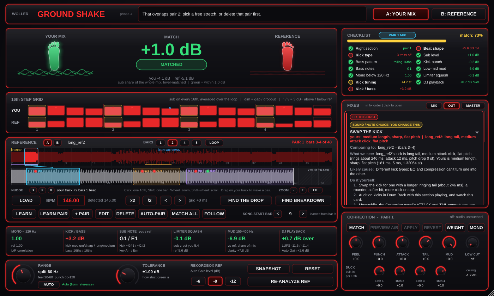

# WOLLER Ground Shake (Phase 4)

A meter for the end of your master chain. It answers one question: **if you were standing on a club floor, how much would your feet feel this sub, and does it match your reference track, every 16th of the way?** Phase 2 adds a coach that tells you what to change, in what order, and how.



## What's in it

| Part | What it does |
|---|---|
| **Two feet** | Left = your mix, right = the reference. Each shakes with its sub. Your foot's colour shows the match: **green** within the tolerance, **yellow** up to 3 dB off, **blue** well under, **red** well over. |
| **16th step grid** | Sub energy on each of the 16 steps, you vs reference. ^ / v = a step 3 dB or more above / below. The open fix card lights up its steps; after a SNAPSHOT a white line shows where each step was. |
| **Reference** | LOAD or drop a WAV, AIFF or MP3. A new reference opens on its **drop**. Drag the window anywhere; **FIND THE DROP** and **FIND BREAKDOWN** jump to those sections (marked on the waveform). |
| **Window length** | **BARS 1 / 2 / 4 / 8**, or **LOOP** to follow the length of your Ableton loop (when Ableton shares it). Your side follows the same length. |
| **Breakdown mode** | Turns on by itself when the reference window has far less sub than the drop (muted or filtered kicks and bass). Ducking, tuning, squash and DJ advice step aside; the Sub level card says *how* the reference muted its kick and bass (high-pass, low-pass or level) and how to match it, e.g. "You're low-passing; the reference high-passes". |
| **Tempo** | BPM and downbeat are detected; x2 / /2, typed BPM and < > nudge (Shift = one 16th) fix mistakes. |
| **Checklist** | 10 live checks with a match %: right section, mono, kick tuning, kick/bass, beat shape, sub level, kick punch, mud, limiter squash, DJ playback. A check ticks only after it holds for one full 8-bar loop pass. |
| **Fix cards** | One card per problem, in fix order, "Fix this first" on top. Sub cards say whether it's the kick 16ths or the roll; a **Careful** line appears if a reading gets worse after a change. Each says what we see, the likely cause, numbered **Kickstart 2** steps with suggested amounts, *worked when*, *too far if*, and progress (start or snapshot -> now). Beat-shape cards draw your beat against the reference's. |
| **Diagnostics strip** | Mono correlation, kick-16th balance, bass and kick notes plus key, sub crest (limiter squash), mud and clarity, LUFS and rekordbox Auto Gain. |
| **Range knob** | The feel/punch split. Auto sets it from the reference's bass note; turn it for Manual. |
| **Tolerance knob** | How strict green is (0.25-3 dB, default 1). |
| **rekordbox ref** | The Auto Gain reference level for the DJ playback check (-6 / -9 / -12 dB). |
| **Snapshot / Reset / Re-analyze** | Freeze readings to compare against; clear everything and measure fresh; re-read the reference file. |
| **Match** | MATCH works out a correction (feel and punch EQ, mono below 120 Hz, optional WEIGHT saturation), PREVIEW A/B plays it level-matched, APPLY keeps it, REVERT removes it. Its ceiling follows the peak level coming out of your limiter (fallback -1 dB). |
| **A / B** | Flip between your mix and the reference, level-matched. |
| **Pass-through** | With Match off and A selected, audio passes through completely untouched. |

## Phase 3: pairs (the whole song)

| Part | What it does |
|---|---|
| **Song start bar** | The Ableton bar your song starts on (default 9, remembered for every project). Below 1 = AUTO: the first bar with sound. |
| **LEARN** | Press, then play your song in Ableton from the start bar to the end; press again (STOP). Ground Shake records it by playhead position (corrections are bypassed so it hears the raw mix) and draws it under the reference. |
| **Pairs** | Press **+ PAIR** (or just drag across your track) and follow the two steps (see Phase 4). Each pair gets its own colour on both waveforms, its own checks, fix cards and correction, measured from the fullest bars inside the stretch. Drag a pair's edges to resize; click it to select. Unmarked parts are left alone. |
| **AUTO-PAIR** | First guess: your drops to the reference's drop, your breakdowns (low sub or low-passed) to its breakdown. Pairs you make by hand always win. |
| **Status lights** | Green, amber or red on every pair, so you can see which section needs work. |
| **Readout per pair** | Click a pair: the checklist, cards, grid and diagnostics switch to it (saved from the learn pass). While that section plays, the readout is live. **FOLLOW** switches to whichever pair is playing; clicking a pair turns it off. |
| **Reference A / B** | Two reference slots. A pair remembers which one it matches; to move it, select it and press **EDIT**. |
| **Sound check** | Kick type (attack, click, ring length, pitch drop) and bass pattern (rolling 16ths, 8ths, offbeat, gallop, reverse, held) come first: if they differ, the card tells you to swap the kick or change the pattern, because EQ can't fix that. |
| **Note check** | Bass notes against your key and the reference's movement, and kick tuning against your key and bass. Advice only: you change it in Ableton or Serum. |
| **Correction per pair** | MATCH (or MATCH ALL) works it out; the knobs adjust it: FEEL, PUNCH, ATTACK, TAIL, MUD (on the kick 16th only), LOW CUT, built-in DUCK per 16th, MONO, WEIGHT. It switches by playhead position with a one-beat glide. Every card says what Ground Shake is doing and how to do it yourself. |
| **LEARN PAIR** | After a mix change, re-learn just the selected pair: press, play that section, it stops by itself. |

The learned recording itself isn't saved with the project (it would be large): pairs, their results and corrections are. After reopening a set, press LEARN (or LEARN PAIR) before measuring new pairs.

Readings that come from the finished master are estimates: the kick note in particular, and the rekordbox Auto Gain prediction. The cards say so.

## Phase 4: line up, guided pairs, OUT lights, master check

| Part | What it does |
|---|---|
| **Shared timeline** | The reference and your track sit on one bar ruler at the same bar width, so bars line up all the way across. Where one track has no audio, its lane is greyed out. |
| **NUDGE < >** | Moves your track one 16th left or right (**Shift**: one bar); **0** lines the starts up again. Only the view moves: pairs, corrections and the export stay on your real Ableton bars. Saved with the project. |
| **Zoom** | Mouse wheel or pinch over the waveforms (Shift+wheel or a sideways swipe scrolls), or **- + FIT**. Zoomed in you see beats and 16ths and the real waveform. |
| **Guided pairing** | **+ PAIR**: step 1, drag across the part of your track to fix; step 2, drag across the reference bars it should sound like (1, 2, 4 or 8 bars), or click a bar to start there with the current length, or **USE WINDOW**. **CANCEL** or Esc stops. Dragging on an empty part of your track starts at step 2 straight away. |
| **EDIT** | Re-points the selected pair with the same two steps (**KEEP BARS** skips a step). Moving the reference window or clicking A / B never changes a pair any more. |
| **MIX / OUT lights** | Every pair shows **MIX** (your mix) and, when its correction is on, **OUT** (with Ground Shake). OUT is worked out in the background by running the learned audio through the correction: no playback needed. MATCH's correction is also fine-tuned this way (level and ducking) until it lands on the reference. The lights are about the low end; limiter squash and DJ playback live in the MASTER view. |
| **MIX / OUT / MASTER** | Chooses what the checklist and cards describe. While a pair plays, MIX reads your mix before the correction and OUT reads what comes out. Kick attack and click readings in OUT are estimates until you play the section (the learned audio is stored at about 16 kHz). |
| **Master check** | Your drop against the reference's drop, level-matched: tone balance above 120 Hz, stereo width above 300 Hz, low-end mono, limiter squash (crest) and drop loudness. Advice cards for your master chain (EQ, imager, limiter), plus where each goes: EQ, imager, limiter, then Ground Shake last. Updates after each LEARN. |

Phase 4 also fixes the built-in ducking, attack and tail bands: they now use a 1st-order split, so a cut is always a cut (the steeper split's phase could turn a duck into a small boost around 100 Hz).

## Use it in Ableton

1. Put **Ground Shake** as the **last device on the Master**, after your limiter.
2. Loop 8 bars and press play. Ground Shake follows Ableton's tempo and bar position.
3. Load a reference. It opens on its drop; drag the window if you're comparing another section.
4. Work through the fix cards from the top. Press **SNAPSHOT** before a change to see what it did; press **B** to hear the reference at the same loudness.

## Get the Mac plugin (GitHub build)

1. Create a new **private** GitHub repository, for example `GroundShake`.
2. Upload everything in this folder (`Source`, `Tools`, `CMakeLists.txt`, `README.md`, `screenshot.png`). The hidden `.github` folder often gets skipped by the browser: add it with **Add file → Create new file**, named `.github/workflows/build.yml`, and paste in the contents of `build.yml`.
3. Open the **Actions** tab and wait for the green check (about 10 minutes).
4. Download **GroundShake-macOS**, unzip it, then double-click **GroundShake-VST3-mac.zip**.
5. Move **Ground Shake.vst3** into `~/Library/Audio/Plug-Ins/VST3/` (replace the Phase 1 copy), then in Terminal:
   ```
   xattr -cr ~/Library/Audio/Plug-Ins/VST3/"Ground Shake.vst3"
   ```
6. In Ableton: **Settings → Plug-Ins**, hold **Option** and click **Rescan**. It appears under **Plug-Ins → WOLLER → Ground Shake**, next to White Noise.

The build is universal (Apple Silicon and Intel). `GroundShake-AU-mac.zip` holds the Audio Unit version for Logic.

## Build locally

Requires CMake 3.22+ and a C++17 compiler (Xcode on Mac). JUCE downloads automatically.

```
cmake -B build -DCMAKE_BUILD_TYPE=Release
cmake --build build --config Release
```

Optional test tools: `-DGS_BUILD_ANALYSIS_TEST=ON` builds `GroundShakeAnalysisTest` (prints BPM, downbeat and the step profile of audio files) and `GroundShakeRenderTest` (drives the plugin with a fake host and saves a screenshot).

## Licence note

Built with JUCE (AGPLv3 or JUCE's commercial licences). Fine for personal use; check JUCE's licence before selling it.
